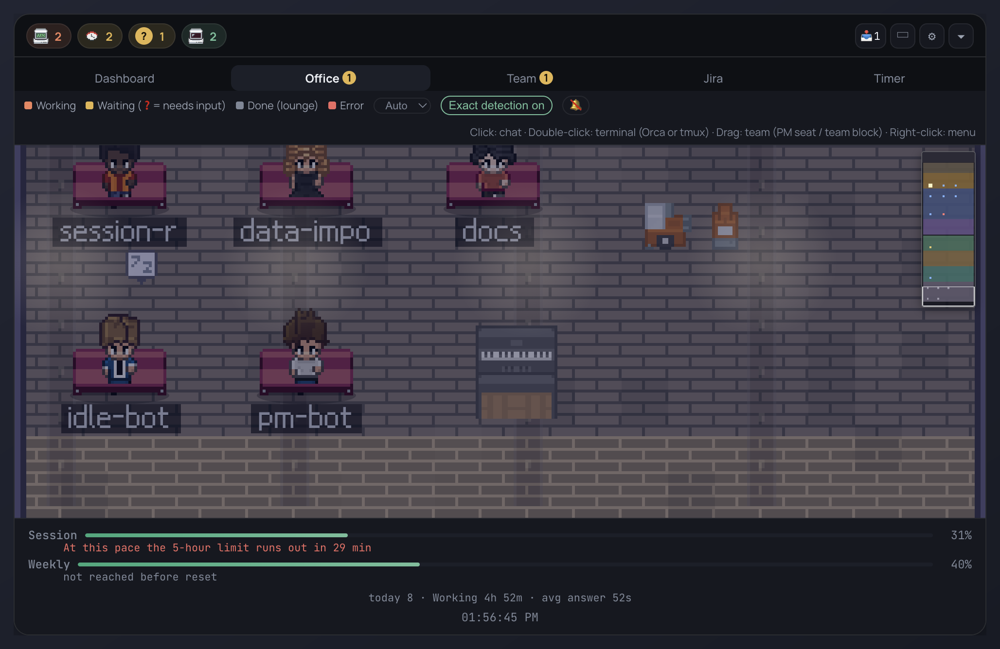
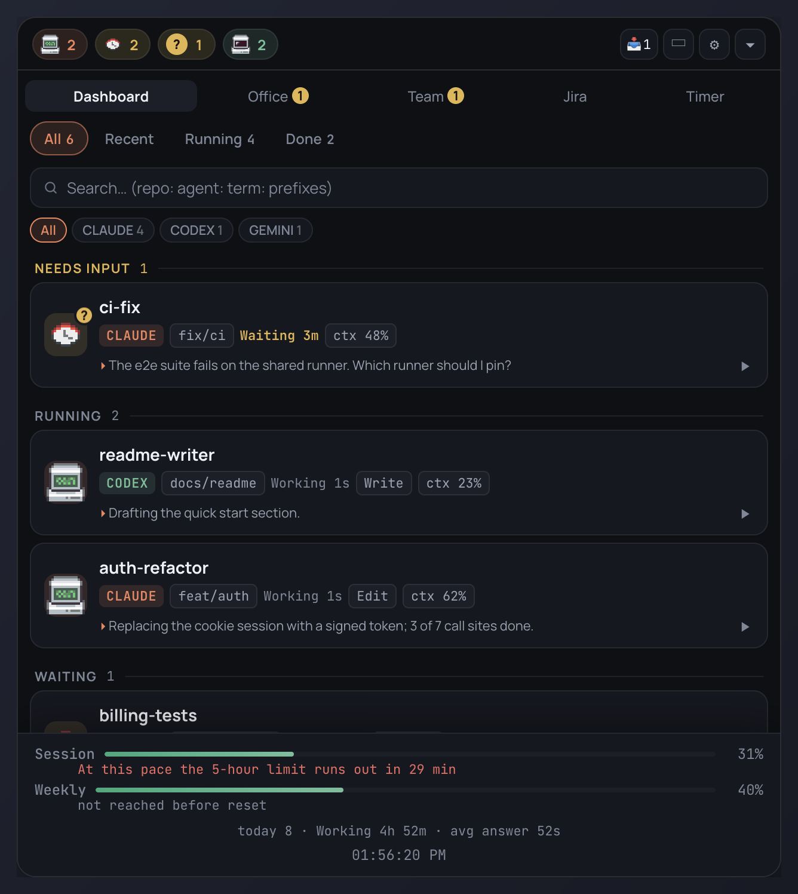
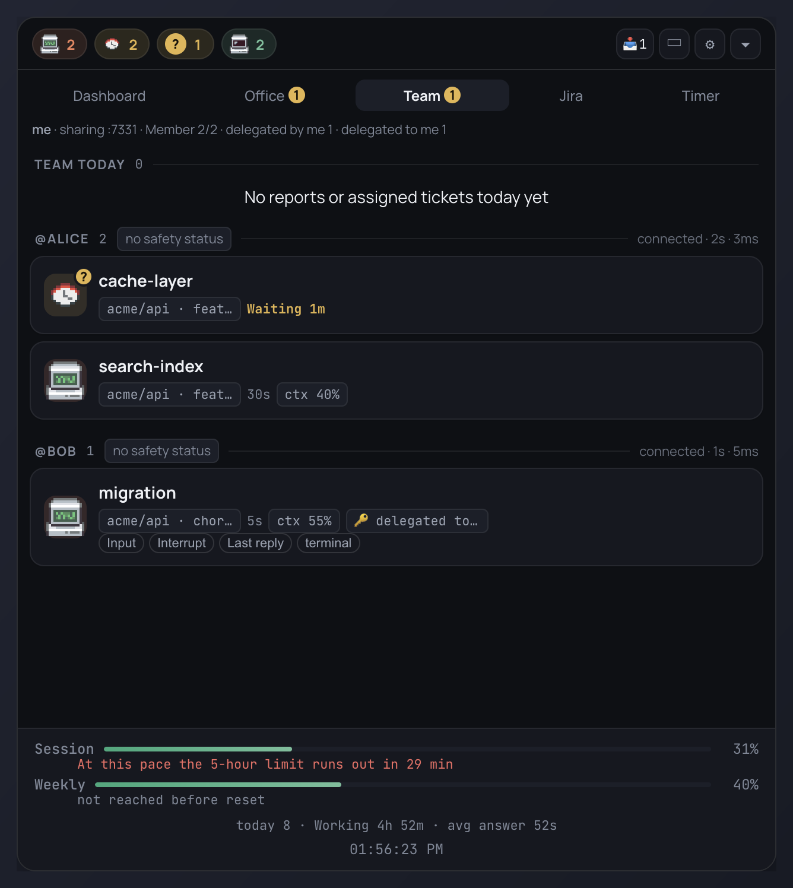
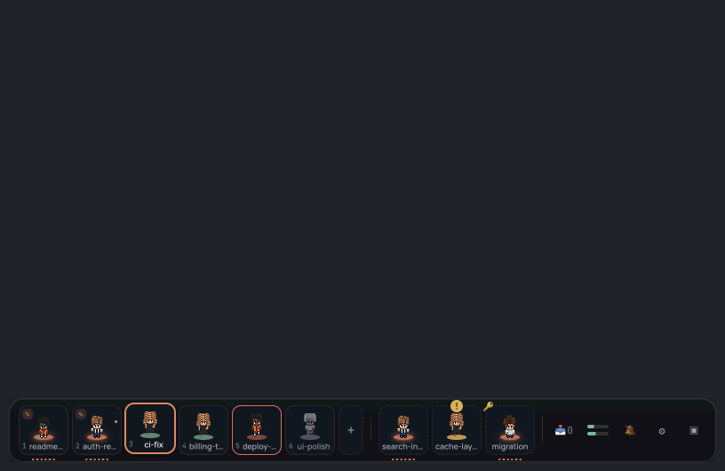

<div align="center">

# AgentDesk

**A pixel-art office for your AI coding agents.**

See every Claude Code, Codex CLI and Gemini CLI session at a glance, answer their questions from a thin dock bar, and share the office with your team. macOS · Linux · Windows.

[](https://github.com/choiminu/AgentDesk/releases/latest)
[](https://github.com/choiminu/AgentDesk/releases)


[Download](https://github.com/choiminu/AgentDesk/releases/latest) · [Quick start](#quick-start) · [Dock mode](#dock-mode) · [Team sharing](#team-sharing) · [한국어 README](README.ko.md)

<sub>[Team sharing guide](docs/TEAM-GUIDE.en.md) · [Jira setup](docs/JIRA-SETUP.md#english) · [Releases and code signing](docs/RELEASE.md) (Korean) · [Contributing](CONTRIBUTING.md)</sub>



</div>

## Why AgentDesk

You run three, five, ten coding agents in parallel. Terminal tabs do not tell you which one is waiting for you, which one is stuck, and which one just finished. AgentDesk does:

- **Know who needs you.** Every session is a card and a character. The one that is waiting for an answer gets a `?` badge, a notification, and a bubble you can answer with one click.
- **Stay in your editor.** The dock bar sits on the edge of the screen. Point at a tile to see that agent's terminal, click to jump to it, press ⌘1–⌘9 to switch.
- **Work as a team.** Share the office over the local network: see teammates' agents, get warned when two of you edit the same file, delegate a session, leave a note.
- **Keep secrets in.** Anything that leaves the machine (Jira comments, Slack replies, team data) is masked first. Approvals and guardrails run locally, with no LLM call in between.

<table>
<tr>
<td width="50%"></td>
<td width="50%"></td>
</tr>
<tr>
<td align="center"><sub><b>Dashboard</b> — state, current tool, context window, last answer</sub></td>
<td align="center"><sub><b>Team</b> — teammates' sessions, delegation, safety status</sub></td>
</tr>
</table>



<p align="center"><sub><b>Dock mode</b> — a thin bar on the edge of the screen; a session that asks a question gets a bubble you answer in place (<a href="docs/screenshots/dock.png">still image</a>)</sub></p>

## Install in a minute

1. Download the installer for your machine from the [latest release](https://github.com/choiminu/AgentDesk/releases/latest): macOS DMG (Apple Silicon or Intel), Linux AppImage or .deb, Windows installer or portable .exe.
2. Start one of your agents (Claude Code, Codex CLI or Gemini CLI) in any terminal. It shows up in AgentDesk within a few seconds, also when it was already running: without hooks as "Detected without hooks" (macOS and Linux), with Exact detection on in its exact state from its next activity.
3. Press ⌘⇧D (Ctrl+Shift+D) for dock mode.

Or run from source:

```bash
git clone https://github.com/choiminu/AgentDesk.git
cd AgentDesk && npm install && npm start
```

*Formerly "Orca Widget". [Orca](https://github.com/stablyai/orca) is optional; any supported agent CLI is enough. Some features (widget approval, guardrail, delegation, usage bar) work with Claude Code only — see [Support by agent](#support-by-agent).*

## Features

- **Live dashboard**: every agent session in a terminal, tmux or Orca with its real state: working, waiting for input, needs a choice, done, error. With Exact detection on, state comes from hook events; Claude Code sessions without hooks are judged from the terminal screen.
- **Pixel office**: each recent session is a character. Working agents sit at station desks (Dev / Research / Exec / Docs, picked from the tools they use) with a live tool tag and a context-window gauge. Subagents appear next to their parent, idle agents rest on the lounge sofa, and a whiteboard on the wall summarizes the room.
- **Dock mode**: turns the widget into a thin bar along the bottom edge of the screen. See [Dock mode](#dock-mode) below.
- **PM teams**: drag an agent onto the PM seat to form a team and drag others in as members. Give the PM a goal: it writes a team brief and proposes a task split, and after your approval each member receives the brief plus its task. Reports flow back to the PM automatically.
- **Needs-input alerts**: notifications, toast, tray badge and an optional chime fire only when an agent is really waiting on you (a permission prompt or a question).
- **Repeat reminders and delegated-session alerts**: a pending approval or an unresponsive session is announced again at a set interval (15 minutes by default, at most twice an hour per session). A teammate's session delegated to you alerts once when it becomes ready for input, needs approval, finishes, fails or stops responding. Set the interval and the unresponsive threshold (30 minutes by default) in ⚙ Settings → Detection & alerts.
- **Review queue (📥)**: click 📥 N in the header to see permission requests, pending Jira reports, change reviews, received notes, teammate join requests, delegated sessions that are ready or need approval, usage warnings and unresponsive sessions in one list, most urgent first. Notes [Send to session], teammates [Add] and permissions [Deny] can be handled right in the list. The queue raises no alerts of its own; choose what it includes in ⚙ Settings → Detection & alerts → **Items in the review queue**.
- **Chat panel**: click any character or card to read the agent's screen and send it a message without leaving the widget. Double-click jumps to its terminal.
- **Team sharing**: see teammates' sessions on the same office network in the Team tab and the pixel office. Create or join a team with an invite code, get warned when two people edit the same file, leave a note on a teammate's session, or delegate a session. See [Team sharing](#team-sharing) and the [team sharing guide](docs/TEAM-GUIDE.en.md).
- **Jira integration**: sign in with Atlassian OAuth, browse tickets on a Kanban board, dispatch a ticket to a new worktree or an existing session, and turn a session's REPORT into a Jira comment draft. See [Jira integration](#jira-integration).
- **Approve permissions in the widget** (Claude Code): answer Claude Code's tool permission prompts with [Allow] / [Deny] on the session card. Off by default.
- **Guardrail** (Claude Code): checks Bash commands and the target path of file edits against risk rules right before they run, then warns or blocks. Off by default.
- **Change view and review comments**: see the git changes of a session's working folder inside its card, comment on lines, and send all comments to the session at once.
- **Session timeline**: a session's hook events on a time axis (tool calls, subagents, approval waits, user waits).
- **Usage forecast and cost per ticket**: an estimated time-to-limit under the usage bar, and an estimated cost summed for every ticket you dispatched from Jira.
- **In-app update**: checks GitHub Releases once a day; [Get it] in the ⚙ Settings "Update" row downloads the installer for this machine.
- **Masking of outgoing text**: Jira comments, Slack replies and team-shared data have secret patterns replaced with `[MASKED]` right before they leave. Test card numbers and email addresses are masked too, and a comment draft says how many places were masked.
- **Slack front desk, morning briefing, session notes**: a front desk that hands Slack requests to a session and posts the REPORT back to the thread, a daily briefing, and session notes (recall). These run only on a machine with a source checkout (`recall/`). See [Session notes (recall)](#session-notes-recall).
- **English and Korean UI**: English by default, switch in ⚙ Settings.
- **Timer**: a Pomodoro timer page; the dock bar shows the time left as well.

### Dock mode

The ▭ button in the header or ⌘⇧D (Windows and Linux: Ctrl+Shift+D) turns the widget into a thin horizontal bar docked to the bottom edge of the screen.

- **Tiles**: one pixel-character tile per session, with the session name under the character and a status ring, queue count badge and subagent dots at its feet. The bar also holds teammates' sessions (with team sharing; 🔑 marks a session delegated to you), the 📥 queue and the usage bar.
- **Status**: a working tile animates and shows the current tool ($, ✎, ≡ and so on) and a bar of tool calls in the last minute. Waiting for input is a green ring, needs approval a yellow ! badge, error a red border. The time in the current state (3m, 1h and so on) sits at the top right and turns yellow after 10 minutes waiting or 30 minutes working.
- **Terminal window**: point at a tile for 0.2 s and a terminal window for that session opens above the bar. It shows the last 200 screen lines, masked and refreshed every second, and has an input line for sending a message while the session waits for input. When a permission prompt is up, [Allow] [Deny] replace the input line; [Interrupt] (after a confirmation) and [To terminal] are there too.
- **Choice bubbles**: when a session waits for a choice (permission prompt, AskUserQuestion, numbered options), a bubble with the question and the option buttons appears over its tile. Buttons arm after 0.8 s, and a prompt the guardrail flags as dangerous only lets you pick "No". With a single bubble open, number keys 1 to 9 pick an option.
- **Done bubble**: when one of your sessions finishes, the first line of its last answer (masked, 80 characters) shows for 8 seconds.
- **Scope of [Allow]**: the dock offers [Allow] only for a Bash command or a short request that fits on one line. File edits and truncated requests go through [View in panel].
- **Clicks and shortcuts**: a click switches to the session's real terminal; a double-click goes to its card in the panel. ⌘1 to ⌘9 (Windows and Linux: Ctrl+1 to 9) switch to the terminal of your n-th tile from the left. These keys work while the widget window has focus. With ⚙ Settings → Other → **Global shortcuts** on (off by default, because the keys may clash with other apps), ⌘⇧D toggles the dock and ⌘⇧A (Windows and Linux: Ctrl+Shift+A) opens the most urgent approval request from any app.
- **Do not disturb (🔕)**: stops bubbles, toasts and desktop notifications; only tile colours and ! badges remain.
- **Order and pinning**: drag one of your tiles between two others to save the order; that session is pinned. Right-click or long-press a tile for "Unpin".
- **New session (＋)**: the ＋ tile at the end of your tiles creates a Claude worktree session from an Orca repository and a name.
- **Drag and drop**: drop text, a URL or a file from another app onto one of your tiles that is waiting for input; after a masked preview, [Send] types it into that session. Files are sent as paths only, and text starting with `/`, `!` or `#` is not sent.
- **Position**: the bar position is remembered per monitor. With "Hide when the pointer is away", the bar slides to the edge 2 s after the pointer leaves and only 8 px stay visible.
- **Settings**: ⚙ Settings → Appearance has start in dock mode, dock size (small, normal, large), auto-hide, done bubbles, dock animation, open the terminal window on hover, and the fade level (off by default).

## Support by agent

Sessions of all three CLIs appear on the dashboard and in the office, but feature support differs.

| Feature | Claude Code | Codex CLI | Gemini CLI |
|---|---|---|---|
| State (hooks) | Yes (18 events) | Yes (11 events, including `PermissionRequest`) | Yes (8 events). Permission waits are seen only through `Notification` (`ToolPermission`) |
| Screen-based state (without hooks) | Yes | No (based on Claude Code TUI text) | No (based on Claude Code TUI text) |
| Approve permissions in the widget | Yes (hook; Windows through a named pipe, not yet verified on real hardware) | No | No |
| Guardrail | Yes (hook; Windows through a named pipe, not yet verified on real hardware) | No | No |
| Choice bubbles (dock) | Yes | No (based on Claude Code TUI text) | No (based on Claude Code TUI text) |
| Delegate to a teammate | Yes | No | No |
| Usage bar and forecast | Yes (with Orca) | No | No |
| Cost per ticket | Yes | No | No |
| Transcript metadata (title, last answer, context) | Yes | Yes | Partial: the context window is taken as 1M regardless of model |
| One-line "doing now" summary | Yes | Partial: needs the `claude` CLI for the summary | Partial: needs the `claude` CLI for the summary |
| Reopen an ended session | `claude --resume` | `codex resume` | `gemini --resume` |

OpenCode sessions are detected from the process list and labelled only; there are no hooks and no reopen command for them.

## Quick start

Requirements: macOS, Linux or Windows, and at least one agent CLI (Claude Code, Codex CLI or Gemini CLI). Running from source needs Node.js 18+. [Orca](https://github.com/stablyai/orca) 1.4+ is optional; without it the widget runs in hooks-only mode (hooks + [tmux](https://github.com/tmux/tmux) for sending messages).

```bash
git clone https://github.com/choiminu/AgentDesk.git
cd AgentDesk
npm install
npm start
```

Prebuilt installers are attached to each [GitHub release](https://github.com/choiminu/AgentDesk/releases) (macOS DMG for Apple Silicon and Intel, Linux AppImage and .deb, Windows installer and portable .exe). Build them yourself with `npm run dist` (macOS), `npm run dist:linux` or `npm run dist:win`.

### Platform support

| Platform | Session states (hooks) | Chat, direct, interrupt | Switch to terminal | Widget approval, guardrail | Reopen ended session |
|---|---|---|---|---|---|
| macOS | ✓ | Orca, tmux, iTerm2, Terminal.app | ✓ | ✓ | iTerm2 / Terminal |
| Linux | ✓ | tmux only | tmux window | ✓ | gnome-terminal, konsole, kitty, alacritty, xterm and others |
| Windows | ✓ | — | — | ✓ through a named pipe (not yet verified on a real Windows machine) | Windows Terminal / cmd |

### First launch of an installer

The installers are not signed with a paid certificate, so each OS asks once on first launch.

<!-- TODO(signing): Developer ID 서명·공증 후 이 안내를 제거 -->
- **macOS**: the app is only ad-hoc signed, so Gatekeeper blocks the first launch. Open it one of these ways:
  - macOS 14 and earlier: right-click (Control-click) AgentDesk in Finder, choose **Open**, then **Open** again in the dialog.
  - macOS 15 and later: open the app once to see the warning, then go to **System Settings → Privacy & Security** and click **Open Anyway**.
  - If you see "damaged and can't be opened", run `xattr -cr /Applications/AgentDesk.app` in Terminal and open it again.
  - A new version downloaded by the in-app update goes through the same check again.
- **Windows**: SmartScreen shows "Windows protected your PC": click **More info → Run anyway**.
- **Linux**: `chmod +x AgentDesk-*.AppImage` and run it, or `sudo apt install ./agentdesk_*_amd64.deb`.

### Onboarding

On first launch a six-step onboarding opens: introduction, environment check, dock and core controls, team sharing, integrations, and updates and settings. Every step has **Skip**. The environment check looks for agent CLIs, the widget hooks, the Orca CLI and terminal control permission, and turns on **Exact detection** in one click. If you close the onboarding with Exact detection still off, the dashboard asks once (**Turn on**, **Later** for this run, **Don't ask again**); nothing is written to your settings files without that click. Exact detection registers hooks in your agent CLIs (see [How it works](#how-it-works)) so states arrive as events instead of being inferred.

To see the onboarding again, use **⚙ Settings → Other → Show onboarding again**. The same section has **Start at login** (installed app only) and **Global shortcuts**.

### Updates

AgentDesk checks GitHub Releases once a day. When a new version is out, the ⚙ Settings "Update" row shows it; [Get it] downloads the installer for this machine (macOS Apple Silicon or Intel DMG, Linux AppImage, Windows installer) to `~/Downloads` and opens it. If there is no matching file or the download fails, the release page opens instead. Versions bump the patch number: `0.2.1`, `0.2.2` and so on.

## Usage

| Action | Result |
|---|---|
| Click a session card | Brings that agent's terminal forward (Orca, tmux, iTerm2 or Terminal); ended sessions reopen with the agent's resume command (`claude --resume` and so on) |
| *Chat* button on a card, or click a character | Opens the chat panel for that agent |
| Double-click a character | Switches to the agent's terminal |
| Right-click | Menu: open chat, show terminal, copy session ID, interrupt, close, team actions |
| Drag a character onto the PM seat | Creates a team with that agent as PM (the template appears while dragging) |
| Drag a character into a team block | Adds it as a member; drop it outside to remove |
| Right-click the PM → *Give the team a goal* | Brief → task plan → approval → dispatch |
| Drag a file onto a card | Inserts the file path into that terminal's prompt |
| ▭ or ⌘⇧D (Ctrl+Shift+D) | Switches to dock mode |
| ▾ / ▴ | Collapse to the header bar / restore |
| ⚙ in the header | Settings: language, theme, exact detection, widget approval, guardrail, alerts, dock, team sharing, updates, show onboarding again and more |

### Reading the office

| What you see | Meaning |
|---|---|
| Blue rug, tool tag above the head, lit monitor | Working. Dots under the tag are the last three tools |
| Yellow rug, character turned around waving, ❓ bubble, timer | Needs your input (permission or question) |
| Green ✓ bubble, no animation | Turn finished, waiting quietly |
| Red rug, blinking ! | Error |
| `↳ name` character on a pale-blue rug | Subagent spawned by the neighbouring session; disappears when it stops |
| Lounge sofa | Idle session (still within the last 24 hours) |
| Gauge under the name | Context-window usage: yellow at 75%, blinking red at 90% |
| Gold team block with 👑 PM | PM team; dotted lines run from the PM to each member, badges show roles and current tasks |
| `@name` area at the bottom | Teammates' sessions shared with you (drawn desaturated) |

The **Auto / 2× / 3× / 4×** control sets the pixel zoom; the bell toggles the chime.

## Team sharing

See the sessions of teammates on the same office network in the Team tab and the pixel office.

- A fresh install is private to this PC: the server listens on `127.0.0.1` only and sends no discovery beacon.
- The team lead clicks **Create our team** in the Team tab, which copies an invite code to the clipboard. Teammates paste it into **Join with an invite code**. Only after a confirmation does the server listen on `0.0.0.0` and discovery turn on.
- What is shared is a summary: session name, repository and worktree folder names, branch, state, current tool name, relative paths of recently edited files and similar. Prompts, answers, tool inputs, full paths and credentials are not sent. Secret patterns are masked before sending and again on receipt.
- Traffic is plain HTTP; the HMAC signature with the team token only prevents forgery and replay. Turn it on only on a trusted office network.
- It warns when two people edit the same file, lets you leave a note on a teammate's session, and lets you delegate one of your Claude Code sessions to one teammate for two hours.

Setup, ports, connection troubleshooting and the security limits of delegation are in the [team sharing guide](docs/TEAM-GUIDE.en.md).

## Jira integration

The Jira tab has two ways to connect.

- **Atlassian OAuth 2.0 (3LO)**: create your own OAuth app in the Atlassian developer console, paste its Client ID and Secret into **Connection** in the Jira tab, and sign in. The callback URL is `http://localhost:47391/callback`. Tokens are stored only in a file encrypted with the OS keychain (Electron safeStorage). Step by step: [Jira setup](docs/JIRA-SETUP.md#english).
- **Orca fallback**: when you are not signed in with OAuth, ticket lists, details and comments go through Orca's own Jira connection (`orca jira …`). The Kanban board needs OAuth.

With OAuth you get:

- **Kanban board**: pick a project and its cards are grouped by the board's columns (or by project statuses when the board configuration cannot be read). **Edit columns** reorders or hides columns (saved on this PC only); a card opens its details in a drawer.
- **Ticket dispatch**: dispatch a ticket to a new Orca worktree or an existing session. Choose an instruction template or a recent instruction and preview the prompt before it is sent. A ticket a teammate's session is working on shows "👤 name working", and dispatching it asks once more.
- **REPORT → comment draft**: when a session reports with a `REPORT_START … REPORT_END` block, a Jira comment draft is built for you. Missing sections are flagged, and nothing is posted until you confirm. The comment is masked right before it is sent.
- **Cost per ticket**: an estimated cost is summed for each dispatched ticket (see [Usage forecast and cost per ticket](#usage-forecast-and-cost-per-ticket)).

## How it works

The widget polls `orca worktree ps` and `orca terminal list` every 5 seconds for the session list, and reads each open terminal with `orca terminal read --screen` every 2 seconds. State is resolved in this order:

1. **Hook events** (exact, when Exact detection is on)
2. **Terminal screen** (inferred, based on the Claude Code TUI)
3. **Orca's own agent state** (fallback)

<details>
<summary>Where sessions come from (Orca and plain terminals)</summary>

| Session kind | Discovered through | Chat, PM teams, interrupt |
|---|---|---|
| **Orca session** | `orca worktree ps` + terminal list; hook events enrich them | Orca terminals |
| **Terminal session** (an agent started in iTerm2, Terminal.app or tmux) | Hook events (`~/.roca/events.jsonl`) + transcript metadata (title from `/rename` or the AI title, last message, context usage, git branch) | tmux panes (`send-keys` / `capture-pane`), or iTerm2 / Terminal.app tabs found through the agent process (AppleScript, macOS); ended sessions reopen on click |

The two kinds are told apart by the `TERM_PROGRAM` the hook script records (`Orca` vs `iTerm.app`, `tmux`, `Apple_Terminal`), so both appear in one list. Agent processes on a terminal that no hook event has covered yet appear as read-only **Detected without hooks** cards (macOS and Linux; not Windows yet). Their state comes from the terminal screen when it can be read (tmux, or iTerm2 / Terminal.app once macOS automation is allowed) and is otherwise shown as done (idle); they raise no done / waiting alerts and are not shared with teammates. When the first hook event of that session arrives, the card turns into the hook card and keeps its name, pin and dock place. Without Orca installed, the dashboard shows a banner, with a one-click button when Exact detection is off.
</details>

<details>
<summary>Approve permissions in the widget (Claude Code)</summary>

Turn on ⚙ Settings → Detection & alerts → **Approve permissions in the widget** (off by default; needs Exact detection). When Claude Code asks for a tool permission, the session card shows the tool name, an input summary and **[Allow] [Deny] [To terminal]**. The summary is the whole command for Bash, the start of the content for Write, the changed lines for Edit, and 1,000 characters of input JSON for other tools. Secrets are masked; invisible and bidirectional control characters are shown as `⟨U+XXXX⟩`. A "N waiting for approval" badge and a desktop notification appear too.

- **The terminal asks as well; whichever answer comes first wins.** Answering in the terminal closes the widget panel.
- Nothing is allowed until you press a button. There are no saved rules such as "always allow"; even when a rule is suggested, only "allow once" is offered. A reason typed when denying is passed to Claude.
- If the input is too long to show in full, [Allow] is disabled and only [Deny] and [To terminal] remain. Buttons ignore clicks for 0.8 s after the panel appears.
- **With the widget not running, the terminal asks as before.** After the wait time (90 s by default; 60/90/180/300 s in Settings) or [To terminal], only the terminal prompt remains.
- How it works: a synchronous hook `~/.roca/perm-hook.sh` is added to `PermissionRequest` in `~/.claude/settings.json` (next to the logging hook). The hook sends the request to the Unix socket `~/.roca/perm/perm.sock` (directory 0700) and authenticates with a random token created at widget start (`~/.roca/perm/perm-token`, 0600, deleted on exit). The widget's answer reaches Claude Code only if its HMAC with the same token checks out. The server accepts requests only for sessions it has seen in hook events. Turning it off removes only this hook.
- Claude Code only (not Codex CLI or Gemini CLI). On macOS and Linux the hook needs `curl` (7.84+) and `openssl`; without them the terminal asks. On Windows the hook is a small Node script that talks to the widget over a named pipe with a random name per run (not yet verified on a real Windows machine; check **Hook connection** in Settings, which shows when a hook last reached the widget).

</details>

<details>
<summary>Guardrail: dangerous-command check (Claude Code)</summary>

⚙ Settings → **Guardrail** (off by default, separate from widget approval) checks each Bash command and each file edit (Edit, Write, MultiEdit, NotebookEdit) against risk rules in `~/.roca/guard.json` right before it runs. Modes are off, warn (default) and block.

- **Warn**: a match asks once more in the terminal (even with `--allowedTools` or bypassPermissions mode). **Block**: block-level rules are refused and the reason is passed to Claude; warn-level rules still ask.
- Built-in rules see the whole Bash command (up to 256 KB) and only the **target path** of file tools, never the file contents. User rules see the first and last 4,000 characters of a command, so a longer command asks for confirmation (unless the mode is off). An input over 2 MB whose target path cannot be found also asks. Inside paths listed in `allowRepos`, only the file-path rules are skipped; Bash is always checked.
- **Out of scope**: MCP tools (`mcp__*`), WebFetch, Read and every other tool, and commands hidden behind variables (`x=rm; $x -rf /`) or written to a script first. It is a seatbelt, not a sandbox.
- **Fail-open**: with the widget not running, or no verdict within the widget's 2 s wait (the hook itself allows 3 s), nothing is blocked. A verdict the hook did not wait for is logged as "passed on timeout".
- User-rule regexes are limited to 500 characters and 20 ms per run. A block-level rule that times out asks for that call, and after timing out on two different inputs it is marked "slow rule" (you decide whether to turn it off). A warn-level rule is turned off after two timeouts.
- Log: `~/.roca/guard-log.jsonl` (0600, last 2,000 lines, secrets masked). The dashboard shows "Guard today N" and session cards a "Guard N" badge.
- How it works: a synchronous hook `~/.roca/guard-hook.sh` (time limit 3 s) is added to `PreToolUse` (matcher `Bash|Edit|Write|MultiEdit|NotebookEdit`) in `~/.claude/settings.json`. It uses the same Unix socket, token and HMAC-checked answers as widget approval. When `jq` is installed, only the fields needed for the verdict are sent. Teammates' remote input is checked against the same rule file (built-in rules always apply).
- Claude Code only. On Windows it uses the same named pipe as widget approval (not yet verified on a real Windows machine; check **Hook connection** in Settings to see that it works).

</details>

<details>
<summary>Exact detection via hooks</summary>

Turning on Exact detection adds widget hooks to every agent CLI installed on this computer: `~/.claude/settings.json` (Claude Code), `~/.gemini/settings.json` (Gemini CLI) and `~/.codex/hooks.json` (Codex CLI). Existing hooks are kept and the previous files are backed up under `~/.roca/`. A CLI installed later is picked up on the next widget start. The hook script `~/.roca/hook.sh` (PowerShell `hook.ps1` on Windows) appends each event as one JSON line to `~/.roca/events.jsonl` and exits immediately; the widget tails that file. Claude Code reloads hook settings live, so running sessions are covered too, from their next activity (a prompt or tool call). Turning it off removes only the widget's entries.

| Hook event (Claude Code / Codex CLI; Gemini CLI name in parentheses) | Widget state |
|---|---|
| `UserPromptSubmit` (`BeforeAgent`), `PreToolUse` (`BeforeTool`; tool name and target recorded), `PostToolUse` (`AfterTool`) | Working |
| `Stop` (`AfterAgent`), `Interrupt` | Waiting (Done after 10 minutes) |
| `PermissionRequest`, `Notification` (`permission_prompt`, `agent_needs_input`, `elicitation_*`, Gemini `ToolPermission`), `PreToolUse(AskUserQuestion)` | Needs input |
| `SubagentStart` / `SubagentStop`, `PreToolUse` inside a subagent | Subagent appears, shows its tool, leaves |
| `SessionEnd` | Done |

Events are matched to sessions by the event's `cwd` and the worktree path. Sessions without hook data fall back to screen reading.
</details>

<details>
<summary>Screen-based detection (Claude Code)</summary>

Screen reading is based on the Claude Code TUI text. The parser anchors on the last `❯` prompt line and looks at the first meaningful line above it, skipping indented hint lines and the status bar.

| Screen | State |
|---|---|
| Spinner line such as `· Working… (1m 14s · ↓ 3.8k tokens)` or `esc to interrupt` | Working |
| A `⏺` response with no spinner below it | Waiting; Done once the screen has been unchanged for 10 minutes |
| `✻ Worked for 22s · done 2:34 PM` within 10 minutes | Waiting |
| Same line older than 10 minutes, or dated another day | Done |
| Numbered choice with a `❯` marker, or `Do you want …` | Needs input |
| Shell terminal without a prompt | Orca state |

Times are parsed in English and Korean formats. The same screen also yields the subagent panel (`⏺ main` followed by `◯ name  description  17s · ↓ 30.5k tokens`) and the context percentage from the status line.
</details>

<details>
<summary>PM teams</summary>

Every instruction sent to a member carries the full team brief (goal, scope, decisions, per-member deliverables, done criteria, forbidden), so members keep the PM's context even after long sessions or compaction. Members are asked to end with a `REPORT_START … REPORT_END` block; when a member finishes, the widget collects the report and asks the PM for the next step (approval dialog by default, or auto-dispatch, capped at 12 rounds). Team layout and logs live in `~/.roca/teams.json`.
</details>

## Change view and review comments

Expand a session card and open the **Changes** tab to see the git changes in that session's working folder.

- Choose **Working tree** (against HEAD, uncommitted changes) or **Whole branch** (against the merge-base with the first default branch found among `origin/HEAD`, `origin/main`, `origin/master`, `main`, `master`). Click a file in the list (status, path, +/−, `U` for untracked) to open its diff by hunk. Beyond 500 files, or 300 KB or 2,000 lines in one file, only the beginning is shown. Binary files are listed without content, and secrets such as tokens and DB URIs in diff lines are masked.
- Click a line number to leave a comment on that line (up to 500 characters). **Send to session** shows a preview, then types the collected comments (up to 20) into the session as one line: `[Review comments · N] 1. path:line — text … Apply the comments above and report with a REPORT block when done.` (line breaks become spaces). Nothing is sent when the screen cannot be read, when the session is stopped at a permission or choice prompt, or when its input box holds an unfinished draft (a running turn is fine). Comments that could not be sent stay in the list.
- A session card shows a **Review changes** badge once when a REPORT arrives (it opens the Changes tab).
- Changes are read only while the card is expanded (30 s cache), and a file's diff only when you click it. The widget never sends paths: the main process opens only the working folders it knows by session ID (Orca `worktree ps`, the hook event's cwd), accepts only relative paths from the latest change list (no `..`, no absolute paths), and does not follow symlinks that leave the repository. A home directory that is itself a repository root is not shown. git runs without a shell, without external diff, textconv or fsmonitor, without index locks (`GIT_OPTIONAL_LOCKS=0`), and at most four at a time.

## Session timeline

Expand a session card and open the **Timeline** tab to see the session's hook events on a time axis (needs Exact detection).

- The summary at the top lists turns, tool calls and failures, subagents, total user wait (answer done → next prompt), total approval wait (permission request → next tool), calls and time per tool, and the five slowest calls.
- There are three lanes: main tool calls (bar length = duration, colour = tool kind, failures with a red border), subagent spans, and waits (approval wait yellow, user wait grey). Hover for time, tool, summary and duration; click to jump to the row in the list below. Zoom to **last 10 minutes / 1 hour / all**.
- The data comes from an in-memory index built while `~/.roca/events.jsonl` is read (last 2,000 events per session, 100 sessions). There are no LLM calls. The part lost to log rotation is shown as "no earlier records".
- Tool input and prompt summaries (120 characters) are masked in the main process before they reach the widget, and are not part of team-shared data.

## Usage forecast and cost per ticket

- **Usage forecast** (Claude Code, needs Orca): under the usage bar (session and weekly usage and reset times from Orca `account list`, `rateLimits.claude`), the widget shows "At this pace the 5-hour limit is reached in about 1 h 40 min (reset 14:30)" or "Not reached before reset". The pace is a linear regression over the last 30 minutes of samples; with few or noisy samples it adds "(uncertain)". Only the last 30 samples are kept in `localStorage` (`roca-usage-samples`).
- **Usage warnings**: when usage crosses 80% and 95% (Settings → Detection & alerts → usage warning thresholds), a toast and a desktop notification fire once per level, and again after the window resets. The bar turns yellow and red at the same values.
- **Cost per ticket** (Claude Code): for each ticket dispatched from Jira, the cost recorded in Claude Code session files of its working folder (`cost-state` in `~/.claude/projects/*.jsonl`) is summed from the dispatch time on. Cards and the drawer show "Cost $X.XX (N sessions)", the board shows today's dispatched total, and the dashboard shows the top three tickets.
- **Note**: this cost is an **estimate** from token counts times list prices. On Pro, Max, Team and Enterprise subscriptions it is not what you are billed, and for API billing the Claude Console usage page is authoritative. A ticket dispatched to an existing session includes that session's cost from before the dispatch.

## Session notes (recall)

`recall/` turns every finished agent session into a short engineering note (findings with `file:line`, decisions, dead ends, open questions) and stores it in a local MongoDB so later sessions can skip re-analysis. The installers (DMG and others) do not include `recall/`, so set it up from a source checkout. The Slack front desk (`~/.agentdesk/slack.json`) and the morning briefing use the same `recall/` scripts.

```bash
brew tap mongodb/brew && brew install mongodb-community && brew services start mongodb-community
cd recall && npm install
node cli.mjs install          # SessionStart + SessionEnd + PreCompact + prompt hooks for Claude Code / Gemini CLI / Codex CLI, and the /recall skill
node cli.mjs backfill --since 7d   # optional: notes for last week's transcripts
node cli.mjs search "iTerm session matching"
```

- **SessionEnd** and **PreCompact** (a compaction is a natural chapter boundary, and a chance to capture sessions that stay open for days) → a detached worker extracts prompts and answers from the transcript (tool output dropped), masks secrets, asks `claude -p` (Haiku, JSON schema enforced) for a note and upserts it into `agentdesk.session_notes` with the git commit, worktree and files it relies on. One note per session, refreshed on each trigger.
- **Every prompt** (including the first one of a session) → the prompt's words are searched in MongoDB and up to 3 matching notes are added as context. A note from the same worktree needs one matching term; a note from another worktree of the same repo needs at least two. Notes whose files changed since they were written are flagged `⚠ N file(s) changed since`.
- **SessionStart** → the branch name, modified files and files of the last commits are used as the query; at most 2 notes from this worktree (or ones touching the files you are editing) are shown, or nothing.
- `/recall` skill and `agentdesk-recall search | show | list [--worktree NAME | --all]` for explicit lookups; MongoDB Compass (`mongodb://127.0.0.1:27017`, db `agentdesk`) to browse the notes. Nothing leaves the machine unless you point `AGENTDESK_MONGO_URL` at a remote cluster.

## Development

```bash
npm run dev          # run with NODE_ENV=development
npm test             # all unit tests (test/*.test.mjs)
npm run dist         # macOS DMGs; dist:linux / dist:win for the other platforms
```

- After editing the inline script in `widget.html`, run `node scripts/csp-hash.mjs --write` to update the CSP hash. With a stale hash `npm test` fails and the widget's CSP refuses to run the script.
- After changing UI strings, run `node scripts/i18n-check.mjs`. It finds Korean strings in `widget.html` that have no English translation. Strings that must stay untranslated go into `scripts/i18n-allow.json`. `npm test` runs the same check.
- Releases and code signing (tags, GitHub Secrets for Developer ID and Authenticode): [docs/RELEASE.md](docs/RELEASE.md) (Korean).

| Environment variable | Effect |
|---|---|
| `ROCA_START_PAGE=office` | Start on a tab (`settings` and others). `office-demo` renders twelve fake sessions (subagents, needs-input, a team). `onboarding` opens the onboarding right away during development. Append `,en` or `,ko` to force a language |
| `ROCA_SHOT=/path/shot.png` | Capture the window at 8 s, 13.5 s and 24 s as `shot-1.png` … |
| `ROCA_DEBUG=1` | Print terminal-read and renderer console logs |
| `ROCA_HOOKS_INSTALL=1` | Register hooks at startup |
| `ROCA_ORCA_BIN=/path/orca` | Force the Orca CLI path |
| `AGENTDESK_JIRA_SITE=https://your-site.atlassian.net` | The Jira site to pick first when the OAuth account can see several |

```
main.mjs        Electron main process: agent CLI hooks, terminal adapters, transcript readers, update check, IPC
jira-oauth.mjs  Atlassian OAuth 2.0 (3LO) sign-in, encrypted token store, Kanban board API
preload.cjs     Context bridge exposed as window.orca
widget.html     Single-file frontend (HTML + CSS + JS): office renderer, dock, team and Jira views
core/           Logic shared by the renderer and the tests (status judgement, dock, Jira, masking and more)
team/           Team sharing: signed HTTP server and client, discovery, delegation, identity keys
perm/           Widget approval server and hook installation
guard/          Guardrail rules and verdicts
diff/           Change view (git diff) readers
recall/         Session notes, Slack bridge, morning briefing (not included in the installers)
test/           node --test unit tests
scripts/        CSP hash, i18n check, build helpers
docs/           Team sharing guide, Jira setup, design notes
assets/pixel/   Sprites and furniture (see CREDITS.md)
assets/fonts/   Galmuri9 pixel font (OFL)
```

## Troubleshooting

- **Empty session list**: the widget looks for `orca` in `/usr/local/bin`, `/opt/homebrew/bin` and `/Applications/Orca.app/Contents/Resources/bin`. If the call fails a red banner explains why. Make sure the Orca app is running and `orca --version` works in a terminal; if needed, `sudo ln -s /Applications/Orca.app/Contents/Resources/bin/orca /usr/local/bin/orca`. To work without Orca, turn on Exact detection.
- **Orca older than 1.4**: screen reading and chat need `terminal read --screen` and `--json`; a banner asks you to update.
- **"Open terminal" or sending a message does nothing**: macOS asks once whether AgentDesk may control iTerm2 / Terminal (Automation permission). Allow it under **System Settings → Privacy & Security → Automation**; without it the widget can still read states but cannot switch to or type into terminal tabs. On Linux only sessions inside tmux can be controlled, and Windows has no terminal control.
- **States look wrong**: turn on Exact detection. Screen reading depends on the Claude Code TUI text; hooks do not.
- **Teammates' sessions do not show up**: see [When it does not connect](docs/TEAM-GUIDE.en.md#when-it-does-not-connect) in the team sharing guide.
- **Jira sign-in fails**: see [Troubleshooting](docs/JIRA-SETUP.md#troubleshooting) in the Jira setup.

## Credits

- Office furniture and character sheets from [Pixel Agents](https://github.com/pixel-agents-hq/pixel-agents) (MIT, Pablo De Lucca)
- Characters based on the [Metro City Free Topdown Character Pack](https://jik-a-4.itch.io/metrocity-free-topdown-character-pack) by JIK-A-4 (CC0)
- Pixel font [Galmuri](https://github.com/quiple/galmuri) by quiple (SIL Open Font License 1.1)
- UI fonts [Manrope](https://github.com/sharanda/manrope) by Mikhail Sharanda and [JetBrains Mono](https://github.com/JetBrains/JetBrainsMono) by JetBrains (SIL Open Font License 1.1)

## Contributing

Issues and pull requests are welcome; see [CONTRIBUTING.md](CONTRIBUTING.md).

## License

[MIT](LICENSE)
